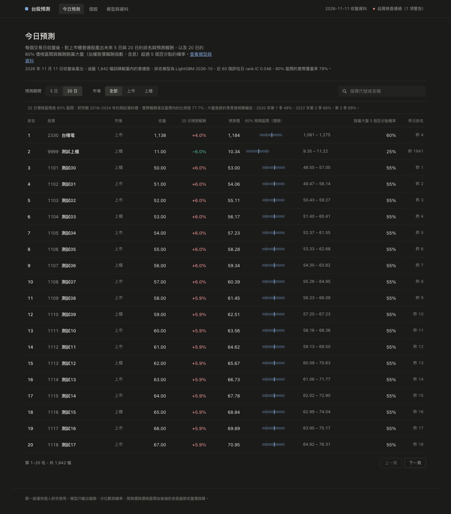
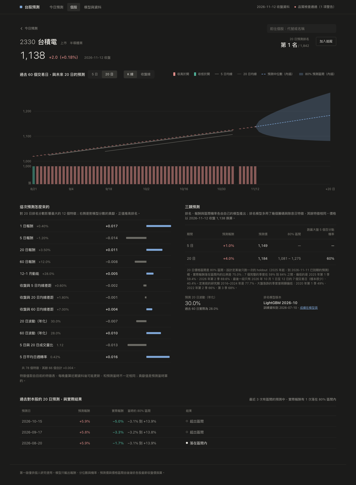
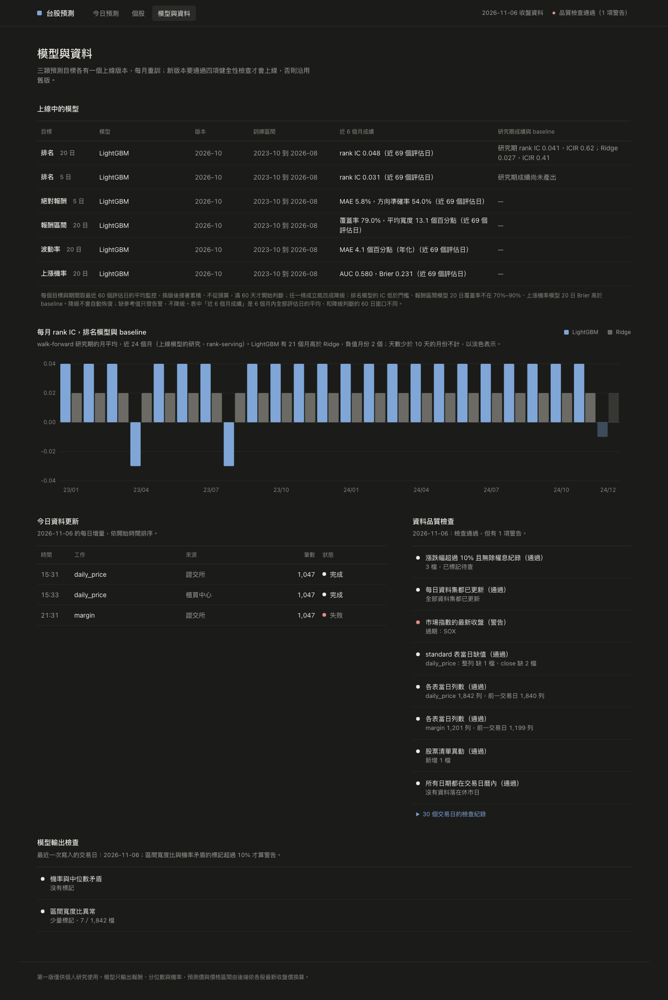

# Phase 5 驗收報告

狀態：使用者 2026-11-18 判定驗收通過。2026-11-17 07:06 在 twp 跑 `phase5_report`：通過 8 項、未通過 0 項、未上線 6 項，未上線的全是 20 日，維持未上線。照使用者 2026-11-16 同意的作法，報告把每一項分成通過、未通過、未上線三種，驗收與否由使用者看表決定。

| 項目 | 內容 |
| --- | --- |
| 驗收條件 | SPEC §9 Phase 5（`docs/SPEC.md:393`）：「API 回傳最新交易日的預測排名、預測價格、價格區間、上漲機率與特徵；回應時間 500 毫秒內」 |
| twp 結果 | 通過 8、未通過 0、未上線 6（全是 20 日）；26 條路徑全部 200，最大 p95 88.0 ms |
| 使用者判定 | 通過（使用者 2026-11-18 判定）。未上線的 6 項全是 20 日，維持未上線、不算通過；等 20 日排名過每月重訓門檻、區間一組放行，或使用者另行決定 |

## 結論

- 5 日：最新交易日 2026-11-16 的排名、預測價格、價格區間都齊全，universe 979 檔一檔不缺；2330 的個股頁與特徵齊全（特徵只檢查 `--stock` 這一檔）。
- 5 日的價格區間來自近 20 日波動估計（`tech_vol_20d`，不是模型的預測），979 檔都是。波動率模型屬於還沒放行的區間一組，所以用的是備援。依規格，5 日的價格區間只由 API 提供，頁面不展示（`docs/SPEC.md:21`）。
- 20 日：6 項都未上線（排名、預測價格、價格區間、上漲機率，以及 2330 的個股頁 20 日與 20 日特徵）。原因是兩道關卡沒過、使用者決定不覆蓋，不是程式缺陷：
  - 排名 20 日：20 日的每一列都由排名模型產生，所以 6 項都先卡在這裡。`rank-2026-11` 沒過每月重訓門檻 (3)，影子模型最近 6 個月 OOS 的 rank IC 是 −0.013（門檻 > 0，樣本 105 天）。使用者 2026-11-13 決定不強制換模，換模改成依期間分組判定（`docs/SPEC.md:337`）。20 日排名要等下一次每月重訓過門檻，或使用者決定強制換模。
  - 區間與機率（分位數、波動率、分類模型，同屬 20 日一組）：holdout 判定「明顯退化」，覆蓋率的逐摺平均 0.7092 低於下界 0.7340。使用者 2026-11-12 決定先不放行（`docs/SPEC.md:313`）。20 日的預測價格取分位數模型的 q50（`docs/SPEC.md:20`），上漲機率來自分類模型（`docs/SPEC.md:21`），這兩項在 20 日排名上線之後還要等這一組放行。20 日價格區間不需要這一組：區間不上線期間改用近 20 日波動估計、以 0 為中心（使用者 2026-11-12 的決定，`docs/reports/phase4-experiments.md:224`；程式在 `apps/api/pricing.py:51-59`），所以它只缺排名模型。
- 上漲機率只有 20 日（`docs/SPEC.md:21`），所以目前沒有任何端點回傳上漲機率。三個頁面都寫明了這一點和原因。
- 回應時間：13 個端點的 26 條路徑全部 200，最大 p95 88.0 ms（`/api/predictions?horizon=5&ordering=-close`），門檻是 500 ms。帶 `horizon=20` 的路徑，以及不帶期間的預測表、特徵與歷史（預設是 20 日），回的是空表，耗時只代表沒有資料時的速度；`/api/stocks/2330/history?horizon=5` 也還沒有到期的預測（見「資料量」），同樣只代表沒有資料時的速度。20 日與歷史有資料時的速度看 seed 那一節。

## 量測當下

- 時間：2026-11-17 07:05:51 到 07:06:12，共 21 秒。資料庫 `twp`，唯讀交易。指令由使用者送出、協調執行，指令見「量測方法」。
- 服務中的程式：第 8 版映像 `36a6971e7b31`（develop `e0ceec3`），2026-11-16 19:58 上線。跑報告的工作目錄在 develop `9a8199f`，和 `e0ceec3` 的 `apps`、`config`、`manage.py`、套件與 Docker 檔相同。
- 服務中的模型：排名 5 日 `rank-2026-11.lightgbm.h5.f000`（holdout 判定「明顯退化」，使用者 2026-11-12 決定放行，2026-11-13 記錄放行後建模），以及絕對報酬 5 日 `return-2026-11.lightgbm.h5.f000`（holdout 判定「達標」）。
- 跑之前四個容器的 CPU 都低於 1%，記憶體 free 46%，沒有還原或備份在跑。跑完後 `etl_run`、`data_quality_log` 的最大 id 和跑之前相同。
- 已知警告：2026-11-16 的資料品質有 1 項 warning（`statement_type_mismatch`：3592 的 2026-Q3 財報，資料庫存的是個別報表，來源給的是合併報表），頁首顯示「品質檢查通過（1 項警告）」。這筆在驗收後的財報修正處理，最晚 2026-11-20。
- 截圖：三個視圖在 2026-11-17 07:06 截好，repo 轉 private 後補上。repo 現在仍放 seed 截圖。

## 驗收檢查

| 條件 | 結果 | 實際值 |
| --- | --- | --- |
| 最新交易日有預測 | 通過 | price_date 2026-11-16，prediction_date 2026-11-16，未上線的期間 20 日 |
| 20 日排名 | 未上線 | 未上線：排名 20 日沒有上線中的模型：rank-2026-11 沒過換模門檻：影子模型最近 6 個月 OOS（未達門檻，實際 -0.013，門檻 rank IC > 0，樣本 105 天） |
| 20 日預測價格 | 未上線 | 未上線：排名 20 日沒有上線中的模型：rank-2026-11 沒過換模門檻：影子模型最近 6 個月 OOS（未達門檻，實際 -0.013，門檻 rank IC > 0，樣本 105 天）；報酬區間 20 日沒有上線中的模型，也沒有換模紀錄 |
| 20 日價格區間 | 未上線 | 未上線：排名 20 日沒有上線中的模型：rank-2026-11 沒過換模門檻：影子模型最近 6 個月 OOS（未達門檻，實際 -0.013，門檻 rank IC > 0，樣本 105 天） |
| 20 日跑贏大盤機率 | 未上線 | 未上線：排名 20 日沒有上線中的模型：rank-2026-11 沒過換模門檻：影子模型最近 6 個月 OOS（未達門檻，實際 -0.013，門檻 rank IC > 0，樣本 105 天）；跑贏大盤機率 20 日沒有上線中的模型，也沒有換模紀錄 |
| 5 日排名 | 通過 | 缺 0 檔；date 2026-11-16，979 檔，universe 979 |
| 5 日預測價格 | 通過 | 缺 0 檔 |
| 5 日價格區間 | 通過 | 缺 0 檔；來源 近 20 日波動估計（不是模型的預測） 979 檔 |
| 2330 個股頁 20 日 | 未上線 | 未上線：排名 20 日沒有上線中的模型：rank-2026-11 沒過換模門檻：影子模型最近 6 個月 OOS（未達門檻，實際 -0.013，門檻 rank IC > 0，樣本 105 天） |
| 2330 個股頁 5 日 | 通過 | 齊全 |
| 2330 的 20 日特徵 | 未上線 | 未上線：排名 20 日沒有上線中的模型：rank-2026-11 沒過換模門檻：影子模型最近 6 個月 OOS（未達門檻，實際 -0.013，門檻 rank IC > 0，樣本 105 天） |
| 2330 的 5 日特徵 | 通過 | date 2026-11-16，5 項貢獻，5 項有原始值 |
| 13 個端點的 26 條路徑都回 200 | 通過 | 全部 200 |
| p95 都在 500 ms 內 | 通過 | 最大 p95 88.0 ms（`/api/predictions?horizon=5&ordering=-close`） |

通過 8 項、未通過 0 項、未上線 6 項。

## 資料量

2026-11-17 07:06 量測當下：

- stock_master 3,071 檔。
- daily_price 7,363,894 列，到 2026-11-16；2330 有 4,133 列。
- feature_daily 6,750,491 列，到 2026-11-16；2330 的 label_daily 有 8,266 列。
- model_run 3943 筆：active 2、candidate 3941。
- prediction 9,922 列，3 個預測日，到 2026-11-16；prediction_contrib 23,814 列。
- model_monitor 0 列，backtest_metric 4,156 列。
- etl_run 825 筆，data_quality_log 24,260 筆。

`model_monitor` 是 0 列，因為線上預測還沒有到期的 5 日 label；第一批 label 到期後才開始監控。同樣原因，2330 的 5 日歷史也是 0 筆。

## 端點耗時

| 端點 | 狀態 | 中位數 ms | p95 ms | 最大 ms |
| --- | --- | --- | --- | --- |
| `/api/stocks/2330` | 200 | 1.2 | 1.5 | 2.7 |
| `/api/stocks/2330/prices` | 200 | 5.2 | 12.8 | 26.7 |
| `/api/stocks/2330/predictions` | 200 | 61.5 | 70.3 | 71.1 |
| `/api/stocks/2330/features` | 200 | 1.6 | 2.0 | 2.9 |
| `/api/stocks/2330/history` | 200 | 10.8 | 12.8 | 14.0 |
| `/api/stocks?q=2330` | 200 | 1.2 | 1.4 | 1.5 |
| `/api/status` | 200 | 36.7 | 39.0 | 40.5 |
| `/api/predictions` | 200 | 3.3 | 5.1 | 5.9 |
| `/api/models` | 200 | 39.0 | 40.9 | 41.6 |
| `/api/models/ic-monthly` | 200 | 21.5 | 24.8 | 26.0 |
| `/api/etl/runs` | 200 | 3.1 | 6.8 | 9.1 |
| `/api/data-quality` | 200 | 13.1 | 37.0 | 38.7 |
| `/api/data-quality/corrections` | 200 | 13.3 | 15.1 | 16.1 |
| `/api/predictions?horizon=5` | 200 | 61.9 | 67.5 | 71.7 |
| `/api/stocks/2330/features?horizon=5` | 200 | 24.8 | 27.1 | 28.5 |
| `/api/stocks/2330/history?horizon=5` | 200 | 11.9 | 22.0 | 25.0 |
| `/api/models/ic-monthly?horizon=5` | 200 | 22.8 | 27.6 | 27.7 |
| `/api/predictions?horizon=5&ordering=-close` | 200 | 78.5 | 88.0 | 93.8 |
| `/api/predictions?horizon=5&ordering=-ret_pred` | 200 | 64.7 | 81.6 | 83.4 |
| `/api/predictions?horizon=5&ordering=-price_pred` | 200 | 72.3 | 85.2 | 88.7 |
| `/api/predictions?horizon=5&ordering=-prev_rank` | 200 | 63.9 | 84.6 | 138.6 |
| `/api/predictions?horizon=20&ordering=-close` | 200 | 3.3 | 4.9 | 6.0 |
| `/api/predictions?horizon=20&ordering=-ret_pred` | 200 | 3.0 | 3.1 | 3.2 |
| `/api/predictions?horizon=20&ordering=-price_pred` | 200 | 3.0 | 3.9 | 3.9 |
| `/api/predictions?horizon=20&ordering=-prob_up_5pct` | 200 | 3.4 | 4.5 | 4.7 |
| `/api/predictions?horizon=20&ordering=-prev_rank` | 200 | 3.0 | 3.7 | 4.4 |

- 20 日沒有上線中的排名模型：帶 `horizon=20` 的路徑，以及不帶期間的預測表、特徵與歷史回的是空表，耗時只代表沒有資料時的速度。

## 量測方法

- 指令：`manage.py phase5_report`。在同一個 process 裡用 Django 的 test client 打 13 個端點的 26 條路徑：13 個端點本身，預設 20 日的三個端點（預測表、特徵、歷史）與 `/api/models/ic-monthly` 另量 5 日（`ic-monthly` 沒帶期間時，只有 5 日排名上線就畫 5 日，見 `docs/api.md:35`，所以這次兩條量的都是 5 日），預測表另量兩個期間各種由高到低的排序（5 日沒有機率，少一種）。每條先打一次暖機，不計入；再連打 20 次，記中位數、p95、最大值。量到的時間包含 view、查詢與序列化，不含網路與 gunicorn。
- 接著透過 API 逐條檢查驗收條件：排名、價格、區間、機率依期間逐頁看全市場 universe 內的股票；個股頁與特徵依期間看 `--stock`（預設 2330），特徵至少要有一項原始值。
- 每一項的結果是通過、未通過、未上線三種之一。那一項讀的模型不在 `/api/models` 的服務中清單時記未上線，實際值寫出缺的模型，以及 `meta.not_live` 裡它沒過的換模門檻；這種項目不算通過也不算失敗。
- 唯讀交易連線，任何寫入都會被資料庫拒絕。throttle 每個 process 各自計數，預設 300/min；26 條路徑共 546 次，加上逐頁讀預測，會超過預設，所以指令把 `API_THROTTLE_RATE` 調高。`DJANGO_ENV_FILE=/dev/null` 讓它不讀工作目錄的 `.env`。
- 沒有未通過才截圖，三個視圖都等資料載完才截。`--views` 會把三張圖寫進 `--out` 所在的資料夾，蓋掉入庫的 seed 截圖；repo 還是 public 時，跑完先把三張圖搬出 repo，不要 commit。`--views` 用的 Playwright 只在 dev 依賴裡，所以在主機上跑。
- 環境：本機 macOS、Docker 的 PostgreSQL 16；跑報告的 process 在主機上，經 5432 埠連 db 容器。

```bash
DJANGO_ENV_FILE=/dev/null PGOPTIONS='-c default_transaction_read_only=on' \
  API_THROTTLE_RATE=100000/min uv run python manage.py phase5_report \
  --out docs/reports/phase5/twp.md --views http://127.0.0.1:8000
```

報告寫到 `docs/reports/phase5/twp.md`，這個檔不入庫，本文的表格是從它抄來的。

seed 那一節的表在 #104 的分支上用 `phase5_report` 量，分支以 develop 977c31b 為底，已含 #76；當時量的是 11 個端點，之後才加到 13 個端點、26 條路徑。seed 那一輪與 seed 截圖由一支 `slow` 測試產生。沒有設 `ACCEPTANCE_OUT` 時這支測試會略過，CI 不跑。它在 seed 上跑同一個 `phase5_report`，不能有未通過的檢查，報告寫到輸出目錄的 `seed.md`：

```bash
ACCEPTANCE_OUT=docs/reports/phase5 uv run pytest tests/e2e/test_acceptance_capture.py
```

2026-11-05 在 twp 上量過一次（當時還沒有模型與預測，最大值 31.4 ms），被這次取代，數字見 git 歷史。

## seed 資料：三類模型與兩個期間都上線時

seed 的內容是 e2e 的基本資料再放大：

- 1,842 檔股票；6 個上線 run（排名 5／20 日、絕對報酬 5 日、分位數、波動率、上漲機率）。
- 70 個交易日裡，每一天每一檔都有 6 個 run 的預測，約 77 萬列，相當於上線三個多月沒換版。
- 2330 的 label：5 日有 65 個交易日，20 日有 50 個交易日（最後 5、20 天還沒到期）。
- 每個 run 有 69 天的監控。
- 研究期有 26 個月的月 IC，2330 有特徵貢獻。

| 端點 | 資料 | 狀態 | 中位數 ms | p95 ms | 最大 ms |
| --- | --- | --- | --- | --- | --- |
| `/api/stocks/2330/predictions` | seed | 200 | 25.5 | 36.4 | 40.8 |
| `/api/stocks/2330/features` | seed | 200 | 8.6 | 9.9 | 10.1 |
| `/api/stocks/2330/history` | seed | 200 | 5.7 | 6.2 | 6.3 |
| `/api/status` | seed | 200 | 15.4 | 18.6 | 18.8 |
| `/api/predictions` | seed | 200 | 21.0 | 27.6 | 30.1 |
| `/api/models` | seed | 200 | 19.4 | 26.1 | 27.4 |
| `/api/models/ic-monthly` | seed | 200 | 4.4 | 5.5 | 5.6 |

上表列出會讀預測表的端點。同一輪的其他端點中位數都在 3 ms 內：stocks、prices、etl/runs、data-quality。同一輪的檢查確認 11 個端點都是 200，p95 都在 500 ms 內，其餘驗收檢查也都通過。各次執行的數字會有變動：中位數大致穩定，最大值受單次延遲影響，兩次執行之間可能差到一倍。

## 預測表變深之後

`/api/models`、`/api/status`、`/api/stocks/{id}/predictions` 都要找服務中 run 的最新預測日。

- 以前是對 run 的全部預測取 `Max(date)`，成本跟著預測天數成長。seed 只有最新一天時，`/api/models` 中位數 18 ms；加深到 70 天後是 113 ms。
- 正常每月換版時，服務中的 run 只有一個月左右的預測。但新版沒過健全性檢查時會沿用舊版，那時天數會一直累積。
- #76 加了 `(run_id, horizon, date)` 的 index，`apps/api/serving.py` 的 `latest_days` 現在每個 run 只查一次 index。

同一份 70 天的 seed，#76 之前與之後的中位數（ms）：

| 端點 | #76 之前 | #76 之後 |
| --- | --- | --- |
| `/api/models` | 112.7 | 19.4 |
| `/api/status` | 48.0 | 15.4 |
| `/api/stocks/2330/predictions` | 90.3 | 25.5 |

上線 6 個月後仍要在 twp 上再量一次，見「待辦」。

## 三個視圖（seed 資料）

圖一：今日預測（seed 資料）。



圖二：個股頁 2330（seed 資料）。



圖三：模型與資料（seed 資料）。



## 待辦

- [ ] repo 轉 private 後，把 2026-11-17 07:06 的三張 twp 截圖放進 `docs/reports/phase5/`，取代 seed 截圖。
- [ ] 20 日排名上線後在 twp 上重跑 `phase5_report`，補 20 日的排名、價格區間、個股頁與特徵；區間一組也放行後再跑一次，補 20 日的預測價格與上漲機率。
- [ ] 上線 6 個月後，在 twp 上用 `phase5_report`（不加 `--views`）再量一次，確認預測表變深之後仍在 500 ms 內。
- [x] 使用者判定 S5：2026-11-18 判定通過，未上線的 6 項（全是 20 日）維持未上線。
- [x] 2026-11-17 07:06 在 twp 上跑 `phase5_report`：通過 8、未通過 0、未上線 6，結果見本文。當時服務中的是第 8 版映像 `36a6971e7b31`（develop `e0ceec3`，2026-11-16 19:58 上線）。
- [x] web 與 worker 在 2026-11-07 23:18 和 prod 設定一起重建（主 repo 33863dc，映像 `sha256:d6f3a4502c2b`）。這兩個映像都停在 33863dc，缺 #130–#133（含 #131 的晚間 60 日重算與 #133 的櫃買借券容忍值）。
- [x] web 與 worker 在 2026-11-08 12:05 換上 develop 51f2c71 的映像（`sha256:56577996c1fa`），帶上 #130–#143。
  - 映像缺 #144、#145：這兩支在 build 之後、換上之前合併，只改主機上跑的 `revenue_company` 回補，worker 的排程不受影響。
  - twp 在 build 前已套用全部 migration，含 Phase 2 的 market 0004。
  - 換上後驗證：healthz、prod 設定與 `DEBUG` False、beat 17 項、concurrency 1、研究排程關閉、沒有未套用的 migration、三個掛載路徑。
  - 新端點 `/api/data-quality/corrections`、`/api/stocks?q=2330` 回 200；`/api/status` 的 `quality` 有 `warning_rows`。
  - 頁首的警告數從 80 變成 1：#136 改成每項檢查只算一次，也不再算資料更正紀錄。資料品質本身沒有變。
  - 舊映像留著，tag 是 `stock-prediction-platform:rollback-33863dc`。
  - 之後合併的頁面改動要等再下一次重建；跑 S5 的 `--views` 前，先重建一次 web。
