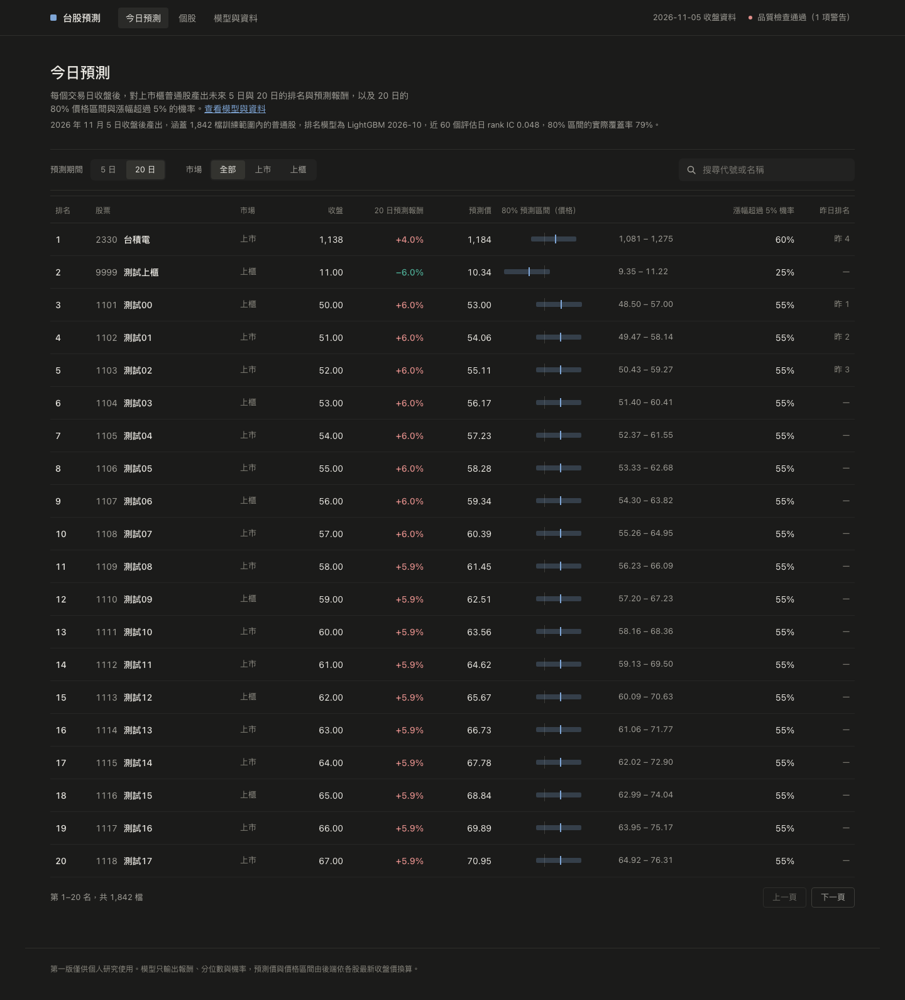
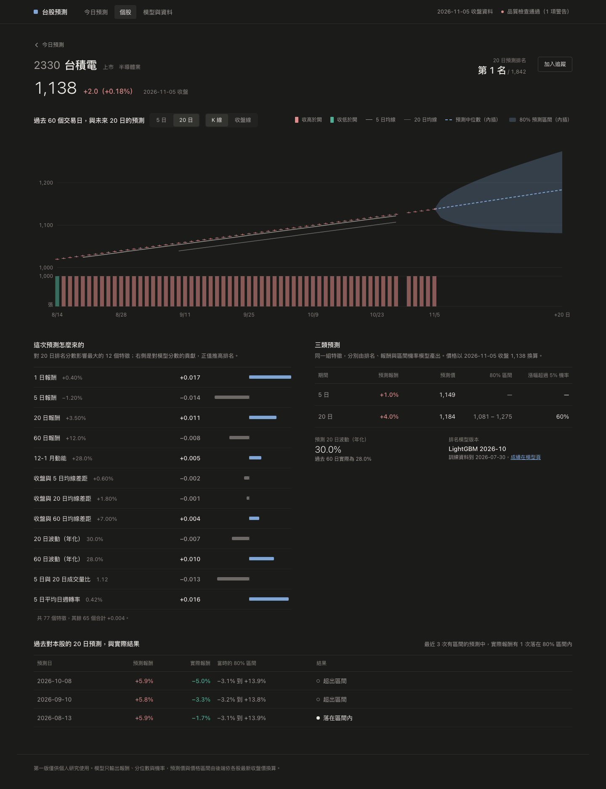
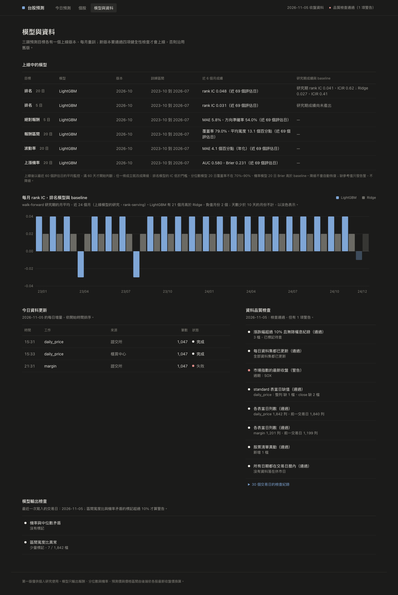

# Phase 5 驗收報告

狀態：部分完成。SPEC §9 Phase 5 的驗收條件是「API 回傳最新交易日的預測排名、預測價格、價格區間、上漲機率與特徵；回應時間 500 毫秒內」。twp 目前還沒有任何模型與預測（Phase 4 的 4.7 尚未上線），所以預測類端點先用 seed 量。S5（回應時間）等 4.7 產出真預測、重量之後再勾。

## 驗收條件

| 條件 | 結果 | 證據 |
| --- | --- | --- |
| 11 個唯讀端點都回 200 | 通過 | 下面兩張表 |
| 資料類端點在 twp 真資料上 500 ms 內 | 通過 | 表一，最大值 31.4 ms |
| 預測、模型類端點 500 ms 內 | 暫定通過（seed） | 表二，最大值 60.8 ms；4.7 之後要重量 |
| 三個視圖可用 | 通過（seed） | 截圖一到三 |
| S5 勾選 | 待辦 | 見最後一節 |

## 量測方法

- 指令：`manage.py measure_api --repeat 20`。在同一個 process 裡用 Django 的 test client 打每個端點：先打一次暖機，不計入；再連打 20 次，記中位數、p95、最大值。
- 量到的時間包含 view、查詢與序列化，不含網路與 gunicorn。
- 環境：本機 macOS、Docker 的 PostgreSQL 16。twp 那一輪是在 2026-11-05 15:54 量的，正好在 ETL 時段內。
- 以 head `44f8b5f` 量測（含 #64、#65）。

twp 那一輪用唯讀交易連線，任何寫入都會被資料庫拒絕。throttle 先調高，不然 20 次連打會被擋：

```bash
DATABASE_URL=<twp 的連線字串> PGOPTIONS='-c default_transaction_read_only=on' \
  API_THROTTLE_RATE=100000/min uv run python manage.py measure_api --repeat 20
```

seed 那一輪與截圖由一支 `slow` 測試產生，只在本機跑，CI 不跑：

```bash
ACCEPTANCE_OUT=docs/reports/phase5 uv run pytest tests/e2e/test_acceptance_capture.py
```

## 表一：twp 真資料

twp 的資料量（2026-11-05 量測當下）：

- stock_master 3,065 檔。
- daily_price 7,349,318 列，到 2026-11-05；2330 有 4,126 列。
- etl_run 213 筆，data_quality_log 98 筆。
- feature_daily 6,736,842 列；2330 的 label_daily 有 8,250 列。
- model_run、prediction、backtest_metric 都是 0 筆。

| 端點 | 資料 | 狀態 | 中位數 ms | p95 ms | 最大 ms |
| --- | --- | --- | --- | --- | --- |
| `/api/stocks/2330` | 真資料 | 200 | 1.1 | 1.4 | 1.4 |
| `/api/stocks/2330/prices` | 真資料 | 200 | 5.6 | 11.1 | 31.4 |
| `/api/status` | 真資料 | 200 | 4.5 | 7.4 | 8.0 |
| `/api/etl/runs` | 真資料 | 200 | 3.8 | 5.2 | 6.9 |
| `/api/data-quality` | 真資料 | 200 | 4.0 | 6.9 | 9.9 |
| `/api/stocks/2330/predictions` | 真資料，沒有預測 | 200 | 3.0 | 4.5 | 4.7 |
| `/api/stocks/2330/features` | 真資料，沒有預測 | 200 | 1.3 | 1.7 | 2.2 |
| `/api/stocks/2330/history` | 真資料，沒有預測 | 200 | 10.7 | 14.3 | 14.7 |
| `/api/predictions` | 真資料，沒有預測 | 200 | 1.1 | 1.3 | 1.8 |
| `/api/models` | 真資料，沒有模型 | 200 | 0.7 | 0.8 | 0.8 |
| `/api/models/ic-monthly` | 真資料，沒有研究結果 | 200 | 1.1 | 1.3 | 1.3 |

後六列只代表「沒有資料時」的速度，不能當驗收依據。驗收看表二。

## 表二：seed 資料

seed 的內容是 e2e 的基本資料再放大：

- 1,842 檔股票；6 個上線 run（排名 5／20 日、絕對報酬 5 日、分位數、波動率、上漲機率）。
- 最新交易日每一檔都有預測。
- 2330 有 69 個交易日的逐日預測與 label。
- 每個 run 有 69 天的監控。
- 研究期有 26 個月的月 IC，2330 有特徵貢獻。

| 端點 | 資料 | 狀態 | 中位數 ms | p95 ms | 最大 ms |
| --- | --- | --- | --- | --- | --- |
| `/api/stocks/2330/predictions` | seed | 200 | 25.8 | 29.3 | 33.1 |
| `/api/stocks/2330/features` | seed | 200 | 8.6 | 9.6 | 10.3 |
| `/api/stocks/2330/history` | seed | 200 | 3.2 | 4.2 | 4.2 |
| `/api/predictions` | seed | 200 | 17.4 | 23.9 | 24.4 |
| `/api/models` | seed | 200 | 17.7 | 23.4 | 25.2 |
| `/api/models/ic-monthly` | seed | 200 | 8.9 | 31.2 | 60.8 |

表二只列預測與模型類端點；同一輪的資料類端點在 seed 上也都在 16 ms 內。測試裡另有斷言：11 個端點都是 200，p95 都在 500 ms 內。各次執行的數字會有小幅變動，例如 `/api/models/ic-monthly` 的最大值是單次離群。

## 三個視圖（seed 資料）

圖一：今日預測（seed 資料）。



圖二：個股頁 2330（seed 資料）。



圖三：模型與資料（seed 資料）。



## 待辦

- [ ] 4.7 在 twp 產出真預測後，用上面兩個指令重量，並重截三張圖，換成真資料的版本；之後勾 S5。
- [ ] web 容器還在跑 4 天前的映像。要等 Phase 2 同意，並避開 15:10–23:00 的 ETL 時段再重建；重建後在這裡記一筆。
